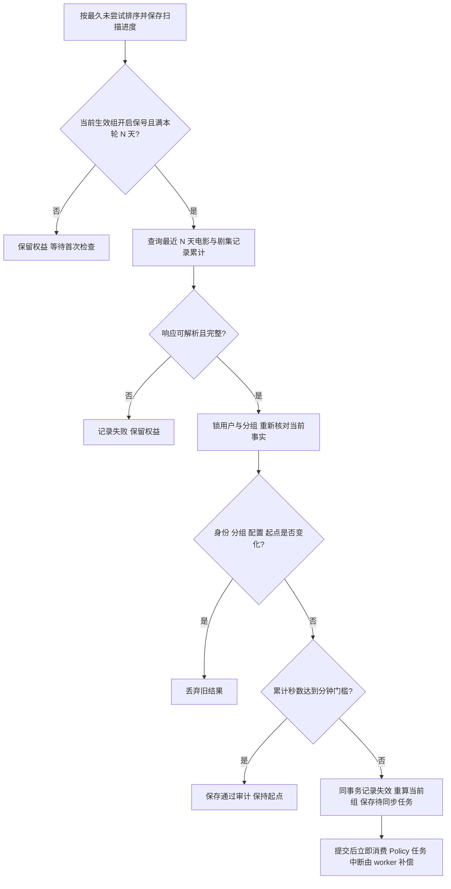

# 观看保号配置与排障

## 开启前

- 应用 `20261008_01_watch_retention.sql`；默认关闭，不会在升级时使存量权益失效。新建 `watch_retention_checks` 审计表，旧 SQL 不改写。
- 升级至扫描恢复修复版本时，同时应用 `20261011_01_watch_retention_scan_progress.sql`，建立每用户一条的扫描进度表；可重复执行，无需回填，不改权益起点或失效状态。
- 协议基线为 Emby 4.9.3.0 + Playback Reporting 2.1.0.7。针对已确认的部署目标，默认沿用版本及合同，仅在版本 / 实例明确变更、记录缺失或冲突、实际响应与合同不符时重新核对；不把版本探测作为每次排查的固定步骤，规则见 [API 合同](../reference/playback-reporting-api-contract.md#11-版本基线复用)。
- Emby 进程时区必须与 `CRON_TIMEZONE` 一致。插件须持续记录目标用户的 Movie/Episode，历史保留期至少覆盖最大的考核周期；插件停用、记录丢失或清理历史后，应先关闭考核并恢复完整采集，确认最近 N 天的数据完整后再开启；重新开启本身不会重置权益周期。
- **成功 SQL 不能证明此前没有丢失记录。** API 能拒绝 SQL 错误、缺列、畸形数值和不完整响应，但无法识别插件已经删除的历史；不得将本轮 mock 检查当作插件历史完整性验收。

## 2026-10-18 起点规则升级

- 新增 `20261018_01_remove_watch_retention_reset.sql`，替换 `plan_groups_watch_retention_valid` 约束并删除 `plan_groups.watch_retention_reset_at`；保留三项配置的取值校验。历史已记账 SQL 不修改。
- API 与 Gateway 都会在启动期执行 migration。先停止旧 API/Gateway，再升级同版镜像，避免旧进程访问已删除字段；Web/Bot 继续使用既有接口。迁移后旧版 API 不可直接回滚，回滚需配套恢复兼容 schema 或升级前备份。
- 迁移不回填、不更改用户权益的实际生效时间、失效标记和历史审计。已有起点的权益直接沿用原值；无起点者记录 `reason=missing_entitlement_start` 并跳过，不能把未知观看判为零。核对可信的实际生效／接替记录后，再单独制定数据修复；不能直接使用用户注册时间或权益表 `created_at`（权益保存可能重建记录）。

## 分组与调度

分组只有三项可编辑规则：观看保号开关、考核周期天数、最低观看分钟数。周期默认 30 天，可配置 1..3650 天；分钟数关闭时可为 0，开启时必须明确填写 1..5256000。数值上限仅用于输入与存储约束，不代表插件实际保留能力。

新建分组或编辑分钟门槛为 `0` 的分组时，表单分钟数保持空白；开启保号后未填写不能提交，不自动补为 `1`。关闭保号时空值提交为 `0`；已有正数门槛在开关切换时保留。

设置中心的 `WATCH_RETENTION_SCHEDULE` 控制考核 cron，默认 `0 2 * * *`，受 `CRON_ENABLED` 总开关控制，使用 `CRON_TIMEZONE`，禁止在表达式中另设时区。支持五字段日历 cron 及 `@daily` 等日历描述符，拒绝依赖进程启动时间的 `@every` 间隔表达式。修改后重启 API 生效；用户首次检查日期使用进程实际注册的表达式，避免提前展示尚未生效的新时间。总开关关闭时保留观看要求，但不展示首次检查日期或“每天检查”。

提交无效 cron 返回 `400` 时，设置中心展示服务端错误并保留草稿，保存按钮恢复可用；修正后可重试，也可使用“重置未保存修改”恢复当前值。

如果升级前已保存 `@every` 或其他无效表达式，API 会记录 `[WatchRetention] 调度配置无效，暂停考核`，只暂停保号任务，不影响其他 cron；用户权益仍可读取。管理员应在设置中心改为如 `0 2 * * *` 的日历 cron，再重启 API。不会静默套用另一时间进行失效判定。

开启、重新开启、修改周期或分钟门槛都保留用户权益原有的实际生效／接替起点。启用后下一次正常调度即扫描：从该起点已满 N 个业务日的参与考核，未满者跳过。修改 N 使用原起点加新的 N 重算首次检查日期；修改分钟门槛不改变日期。配置保存不直接执行考核或追补历史批次。关闭保号停止考核，不恢复已失效权益。

## 实际流转



正常付费组 B 生效时，保底组 A 不考核；A 实际接替时重开完整 N 天。再次从 B 回到 A 仍重新给 N 天。只考核当前生效组，其他持有权益不同时扣减资格。自然到期继续由既有到期任务处理。

统计按 `[执行时刻 - N 个业务日, 执行时刻)` 选取开始播放的记录，累计 `PlayDuration - PauseDuration`。多设备相加，不逐秒拆分跨窗口会话，不去除设备重叠；不使用排行榜快照或排行榜门槛。

查询在事务外执行；落库前重新锁用户和分组，核对 Emby 身份、当前组、期限、考核起点及规则。失效标记、当前组回退和待同步 Policy 任务在同一事务提交，任务无法保存时整个失效事务回滚，人工禁用/停用不被清除。其他有效组可接替，全部不可用时关闭资源访问。

扫描进度独立存于 `watch_retention_scan_states`，不属于观看结果审计。每轮按 `last_attempt_at` 从旧到新处理，无记录者优先；在状态读取和外部查询前记录尝试，查询失败、取消或进程中断后也能继续推进。整轮预算仍为 10 分钟，下一轮优先处理未触达用户；它不保证超出处理能力的全部用户仍能每天完成，容量不足应结合候选数量和完成记录排查。

## 查看与恢复

- 用户概览仅显示当前组要求；账号中心逐条展示开启保号的权益要求。文案使用“观看要求”，提供首次日期或每日检查提示，不使用“观察期”术语。
- `watch_retention_checks` 保存用户、组、窗口、本轮起点、周期、门槛、累计秒数和是否失效。`[WatchRetention]` 日志区分读取失败、统计失败、状态变化、考核落库和同步失败，不记录外部完整响应。
- 自动失效由 `user_entitlements.watch_retention_invalidated_at` 表示，与永久/限时类型独立。普通重算、关闭开关或后续观看不自动恢复。
- 重新购买相应组，或管理员通过现有权益操作明确授予/恢复，清除该组失效标记；实际生效时重新起算。购买其他组保留原组失效状态。
- Policy 同步失败保留已经提交的本地结果，使用既有失败任务与管理员重试；不能声称远端已成功禁用。
- 本地提交后尚未同步便退出时，已保存的 pending 任务由每分钟 Policy worker 消费；处理中退出时沿用 15 分钟超时回收。新保号变更会替换活跃任务的 ID 并保留批次关系，旧任务完成不能吞掉新变更。即时消费只处理对应用户，不提前消费其他用户任务。

## 线上日志观察

日志随包含本次改动的 API 版本上线生效，无需开启 debug。标准 Compose 部署在部署目录执行：

```bash
docker compose logs --since=24h -f ember-api 2>&1 \
  | rg --line-buffered 'WatchRetention|观看保号|PolicyWorker|reason=watch_retention|Emby Policy 同步任务'
```

API 同时将日志保存到 `api_logs` 卷内的 `api-YYYY-MM-DD.log`。先按 `checkedAt` 核对同一轮保号，再按 `userId`、`taskId` 和 `reason=watch_retention` 追踪权限同步；业务时间字段使用 `CRON_TIMEZONE`。

| 关键词 | 判断口径 |
| --- | --- |
| `[WatchRetention] 调度注册成功` | `schedule/timezone/nextRun` 来自已注册的 cron；这里只证明注册成功，到点执行还需看到本轮日志 |
| `调度未启用 reason=cron_disabled` | 全局 cron 开关关闭；无效表达式另有“调度配置无效，暂停考核”日志 |
| `考核起点缺失` / `reason=missing_entitlement_start` | 权益缺少可信起点，跳过且不查询播放、不产生失效；汇总计入 `skippedInactive`，按日志核对历史记录 |
| `开始考核` / `本轮结束` | 同一 `checkedAt` 下核对候选人数、执行结果和耗时；查询候选失败时仍有失败日志及结束汇总 |
| `考核完成 ... committed=true` | 考核记录与本地状态事务已提交；`invalidated=true` 为该组权益本次失效，`policyChanged=true` 表示访问投影变化并已写入待同步任务，不代表远端已同步 |
| `[PolicyWorker] 同步任务已结束` | 当前 `taskId` 的终态已持久化，`status=synced/failed` 分别为同步处理完成/失败；管理员或未绑定账号的跳过行为仍以对应 `[Policy] 跳过` 日志为准 |
| `忽略过期任务结果` | 旧任务已被替换或不再处于 processing；`targetStatus` 只是旧结果，不能作为新任务完成的证据 |
| `同步终态保存失败` / `本次未领取用户任务` | 分别表示终态落库失败/本次没有领取 pending 任务；后者可能已有其他 worker 处理，需继续按用户查任务终态 |

“本轮结束”的 `status` 为 `completed`（扫描正常结束）、`partial_failure`（扫描结束但存在处理失败）、`failed`（配置或候选读取失败）、`canceled`（上下文取消/超时）或 `interrupted`（异常退出时执行了 defer）。进程被强制终止不保证打印结束汇总，不能把日志缺失当作成功。

汇总字段：`candidates` 为候选人数，`attempted` 为已开始处理人数，`remaining` 为尚未开始人数；`passed/invalidated` 只统计已提交的新考核结果。`skippedInactive/skippedGrace/skippedUnbound/skippedChanged/skippedDuplicate` 分别为不再符合条件、未满本轮周期、未绑定 Emby、统计期间状态变化、重复考核。常规跳过按轮汇总，避免逐用户刷屏。

`failed` 是处理失败数，包含即时同步调用失败，因此可能与 `invalidated` 重叠；`syncRequested` 是已提交的同步意图数，`syncDispatchFailed` 是即时调用失败数。`status=completed` 与 `failed=0` 不能替代每个同步任务的终态：任务可能未被本次调用领取，或等待后续 worker。后续 worker 的成功/失败数量属于该次同步执行摘要，判断具体任务是否结束以 `taskId` 终态日志为准。失败日志保留步骤和错误类型，不打印原始上游响应或凭据。

## 历史权益起点恢复

旧权益可能早于保号字段创建，或曾依赖已移除的分组启用时间兜底。遇到 `missing_entitlement_start` 时，应核对当前权益的连续生效周期，不能将购买时间、注册时间或权益行创建时间直接当作起点。

1. **收集独立证据。** 优先使用权益事件的前后快照和实际重算时间，并以订单 / 兑换记录、旧组有效期、注册或回退日志交叉核对。持有低等级权益时若仍由高等级组提供访问权，起点应取实际接替时刻。
2. **确认周期连续。** 排除后续转组、撤销、失效、管理员重新授予等会重启周期的操作。普通续期或无关权益发放不应覆盖已有连续周期。
3. **明确时间精度。** 精确事件时间优先。只有生效时刻被可信证据限制在明确区间内，且使用 `FirstWatchRetentionCheck` 验证区间两端首次考核结果一致时，才能采用已确认生效的上界；保留上下界、来源和精度，不冒充原始精确时间。区间影响首次日期或连续周期无法确认时，不自动回填。
4. **受控写入。** 经数据修复授权后，按固定顺序锁定用户和权益，复核当前组、访问权、完整权益快照及事件水位。只更新仍为空的目标起点，同事务写入唯一来源键的权益审计，保留完整前后状态；审计时间使用实际修复时间。并发变化或审计失败应整批回滚，重复执行须核对既有结果一致。
5. **提交后复核。** 逐条对照核实清单检查起点和首次考核日期，确认未改变其他权益或账号状态；回填本身不补跑考核、不触发外部同步。

回填名单、账号标识、原始证据、生产快照和执行回执保存在 Git 忽略的私有运维目录。公开文档仅维护恢复方法与约束，不记录具体实例的排查或修复流水。

## 验证方式与边界

| 验证层 | 覆盖内容 |
| --- | --- |
| Go mock / 合同测试 | 起算与周期边界、达标 / 不达标、异常不误失效、事务回滚、插件请求与响应语义、全局时区及 cron 注册 |
| 专用 PostgreSQL 隔离集成 | migration 重放、规则修改保持起点、失效不可自动复活、重新授予、提交后同步中断恢复、任务替换和跨轮扫描 |
| Web / Bot 自动化 | 分组表单、首次日期与权益状态展示、失效权益格式化；依赖均使用 fake |

在 `services/api` 执行数据库集成验证前，配置指向专用测试库的 `EMBER_INTEGRATION_DATABASE_URL`；测试使用独立 schema 并自动清理：

```bash
go test ./internal/app -run '^TestIntegrationWatchRetention' -count=1 -timeout=180s
```

集成测试的播放统计与 Policy 依赖为 fake，不证明真实部署的历史采集完整性或外部写入结果。真实环境核验需在授权范围内分别对照观看统计、考核审计、本地权益、同步任务终态与 Emby 实际权限；HTTP 成功或任务完成日志只证明对应步骤。

其他测试入口见[测试运行手册](./testing.md#观看保号回归)。
